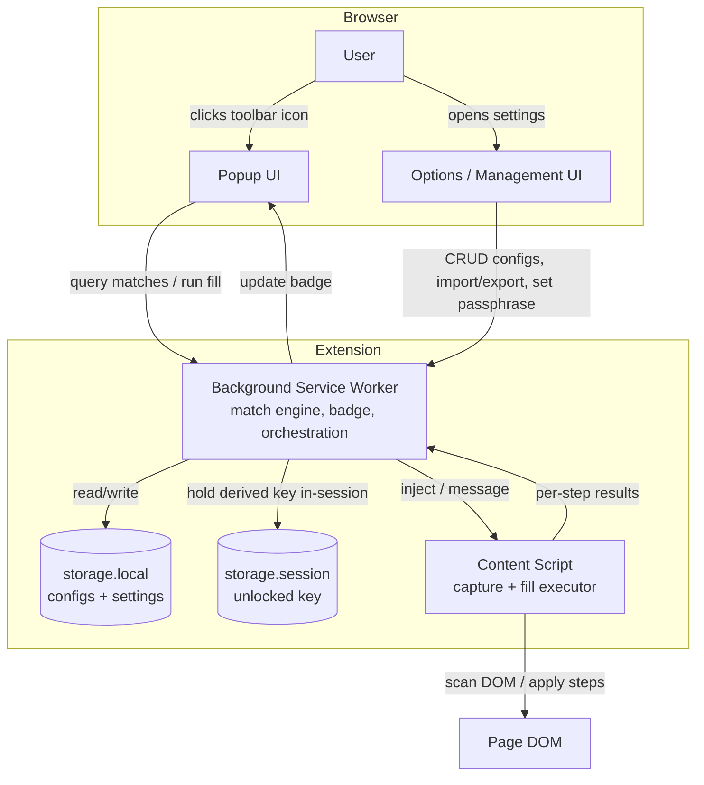
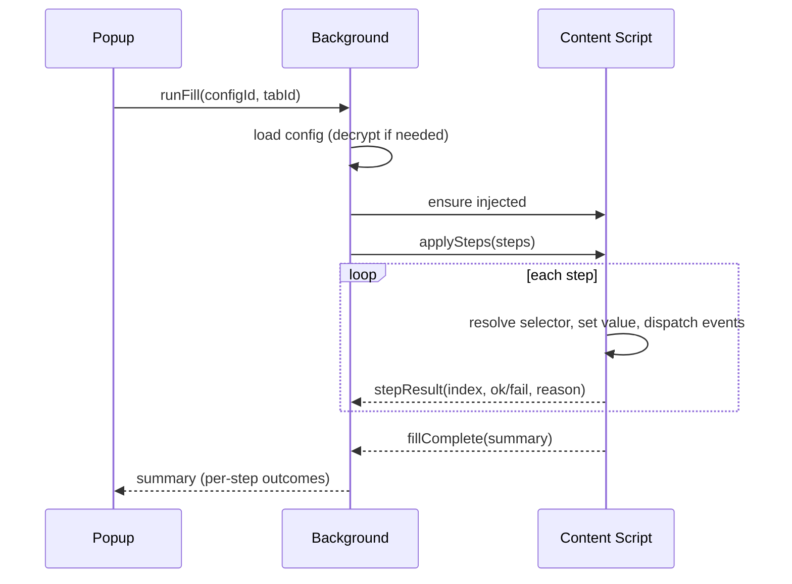
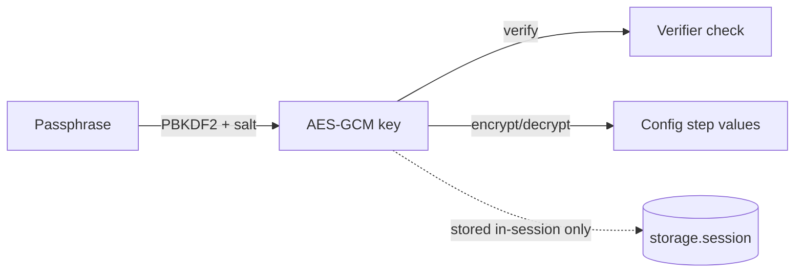

# Design Document

## Overview

Fillibuster is a Manifest V3 browser extension for Chrome and Firefox that fills web forms from saved, reusable "fill configs". A config names a page (via URL pattern rules) and holds an ordered list of field steps, each of which targets an element by a stable selector and sets a value. When the active tab's URL matches one or more configs, the toolbar icon shows a badge; clicking it opens a popup that lists matching configs and runs the chosen one against the page. Configs are managed on an options page, exported/imported as JSON for sharing, and stored locally. Encryption is fully opt-in behind a single master passphrase.

This document describes the architecture, component responsibilities, data model, cross-browser strategy, the matching and fill engines, the encryption scheme, and the packaging/build approach. It maps each area back to the requirements.

### Design goals

- **Single codebase, two browsers.** One source tree builds both a Chrome and a Firefox artifact (Req 1).
- **Frictionless by default.** No passphrase, no setup; encryption is opt-in (Req 8.3–8.5).
- **Forward-compatible config format.** v1 supports simple native controls but the schema leaves room for v2 step types like async autocomplete (Req 3.5).
- **Local only.** No network calls with user data (Req 8.2).
- **Clear feedback.** Every fill and import reports per-step / per-item outcomes (Req 9).

### Technology choices

- **Language:** TypeScript, for a typed config model and safer refactors.
- **UI:** A lightweight component approach for the popup and options page. Preact (React-compatible, tiny) is the default choice; plain TS + DOM is an acceptable fallback. The framework choice is isolated to the UI layer and does not affect the core engines.
- **Bundler:** Vite (or esbuild) producing per-target builds.
- **Cross-browser API shim:** `webextension-polyfill` so extension APIs are promise-based and uniform across Chrome and Firefox.
- **Crypto:** Web Crypto API (`crypto.subtle`) — PBKDF2 for key derivation, AES-GCM for authenticated encryption. No third-party crypto library.

## Architecture

### Component diagram



### Runtime components

**Background service worker (`background/`)** — the coordinator. It:
- Owns the config store: reads/writes `storage.local`, keeps an in-memory index.
- Runs the **match engine**: on tab/URL updates, evaluates the active URL against all configs and sets the toolbar badge (Req 4).
- Handles messages from popup and options (list matches, run fill, CRUD, import/export, lock/unlock).
- Holds the derived encryption key in `storage.session` while unlocked (Req 8.8), never persisting the passphrase.
- Injects the content script on demand and relays fill requests / results.

Under MV3 the service worker is ephemeral (it can be torn down when idle). All durable state lives in `storage.local`; the in-memory index is rebuilt lazily on wake. The unlocked key lives in `storage.session`, which survives worker restarts within a browser session but clears on browser close.

**Content script (`content/`)** — runs in the page context and does the DOM work:
- **Capture:** scans the page for fillable controls and returns candidate steps with stable selectors (Req 2.2–2.6).
- **Fill executor:** resolves each step's selector, applies the value per control type, and dispatches native input/change events (Req 3, Req 5b). Returns per-step results (Req 9.1).
- Detects SPA URL changes (History API + `popstate`) and notifies the background so matches re-evaluate (Req 4.4).

**Popup UI (`popup/`)** — opens on toolbar click. Lists configs matching the current tab, lets the user run one, shows live progress and a per-step result summary, and offers "capture this page" / "open settings" when nothing matches (Req 5).

**Options / management UI (`options/`)** — full CRUD over configs and steps, reorder, delete-with-confirm, import/export, and the encryption settings (enable/disable, set/change master passphrase) (Req 6, 7, 8).

### Message flow examples

Running a fill:


## Data Model

### Config schema (stored + exported)

```ts
type SchemaVersion = 1;

interface FillConfig {
  id: string;                 // uuid
  name: string;
  match: MatchRule[];         // URL rules; page matches if ANY rule matches (Req 4.1)
  steps: FieldStep[];         // ordered (Req 5.3)
  errorStrategy: "stop" | "continue";  // (Req 9.2, 9.3)
  encrypted: boolean;         // whether step values are stored ciphertext (Req 8.6)
  createdAt: number;
  updatedAt: number;
}

interface MatchRule {
  kind: "exact" | "prefix" | "glob";   // (Req 4.1)
  pattern: string;                      // e.g. "https://dmv.example.com/apply*"
}

// Discriminated union on `type` so v2 step types (e.g. "autocomplete") slot in
// without breaking v1 configs (Req 3.5).
type FieldStep =
  | TextStep
  | SelectStep
  | CheckStep
  | ContentEditableStep;

interface BaseStep {
  id: string;
  label?: string;             // human note shown in the editor
  target: Selector;
}

interface Selector {
  // Resolution order mirrors capture preference (Req 2.3)
  by: "id" | "name" | "css";
  value: string;
}

interface TextStep extends BaseStep {        // input[type=text|email|...], textarea (Req 3.1)
  type: "text";
  value: string;
}

interface SelectStep extends BaseStep {       // native <select> (Req 3.2)
  type: "select";
  value: string;
  matchBy: "value" | "text";                  // select option by value or visible text
}

interface CheckStep extends BaseStep {        // checkbox / radio (Req 3.3)
  type: "check";
  checked: boolean;
}

interface ContentEditableStep extends BaseStep {  // contenteditable (Req 3.4)
  type: "contenteditable";
  html: string;               // set as textContent unless allowHtml
  allowHtml?: boolean;
}
```

### Storage layout (`storage.local`)

```ts
interface StoredState {
  schemaVersion: SchemaVersion;
  settings: {
    encryptionEnabled: boolean;      // (Req 8.3, 8.4)
    kdf?: {                          // present only when encryption enabled
      salt: string;                  // base64
      iterations: number;            // PBKDF2 iterations
    };
    verifier?: string;               // AES-GCM of a known constant, to check passphrase (Req 8.9)
  };
  configs: Record<string, StoredConfig>;
}

// A stored config; when `encrypted`, the per-step secret values are replaced by
// ciphertext envelopes and moved into `cipher`.
type StoredConfig =
  | ({ encrypted: false } & FillConfig)
  | ({ encrypted: true } & Omit<FillConfig, "steps"> & { cipher: CipherEnvelope });

interface CipherEnvelope {
  iv: string;                        // base64, per-encryption random
  data: string;                      // base64 AES-GCM ciphertext of JSON.stringify(steps)
}
```

Configs live under a single top-level key (or one key per config) in `storage.local`. Given the ~10 MB Chrome cap (Req 8.12) and the tiny size of configs, a single object is simplest; we monitor total bytes with `getBytesInUse` and warn past a threshold (e.g. 80% of 10 MB).

### Export format

Export wraps a single config in an envelope with a version and app marker so imports can validate and version-gate (Req 7.1, 7.4, 7.6):

```json
{
  "app": "fillibuster",
  "schemaVersion": 1,
  "config": { "...": "a FillConfig with plaintext steps" }
}
```

Encrypted configs are decrypted before export (values become plaintext in the file), so the UI warns the user before producing the file (Req 7.7). On import, a name collision offers "keep both" by suggesting a new name (Req 7.5).

## Cross-Browser Strategy (Req 1)

- **Manifest V3 for both.** Chrome requires MV3; Firefox supports MV3 with `background.scripts`/event pages. We maintain per-target manifest fragments and merge at build time (Chrome uses `service_worker`; Firefox uses `background.scripts` with an event page, plus `browser_specific_settings.gecko.id`).
- **`webextension-polyfill`** normalizes the `chrome.*` vs `browser.*` namespaces and gives promise-based APIs everywhere.
- **Feature detection** for the few divergent behaviors (e.g. badge text APIs: `action.setBadgeText` exists in both under MV3). Any remaining divergence is isolated behind a small `platform/` adapter module so engines and UI stay browser-agnostic.
- **Build produces two artifacts** from one source (see Build & Packaging), satisfying Req 1.4.

## Matching Engine (Req 4)

Lives in the background worker and in a shared pure module so it can be unit-tested without a browser.

- On `tabs.onUpdated` (status/URL) and `tabs.onActivated`, and on SPA-navigation messages from the content script (Req 4.4), the worker takes the active tab URL and evaluates it against every config's `match` rules.
- Rule kinds (Req 4.1):
  - `exact` — full URL string equality.
  - `prefix` — URL starts with the pattern.
  - `glob` — wildcard match; `*` matches any run of characters. Implemented by escaping regex metacharacters then translating `*` to `.*`, anchored.
- A config matches if **any** of its rules match. The set of matching config IDs per tab is cached.
- Badge (Req 4.2, 4.3): if the match set is non-empty, set badge text (e.g. the count) and a distinct color; otherwise clear it. Badge state is per-tab via `setBadgeText({ tabId })`.
- Restricted pages (browser internal pages, extension gallery) can't run content scripts; the engine still matches on URL for the badge, but a fill attempt surfaces a clear "can't run here" message (Req 9.4).

## Fill Executor (Req 3, 5, 5b, 9)

Runs in the content script. Given an ordered `FieldStep[]` and an `errorStrategy`:

1. For each step, resolve the target:
   - `by: "id"` → `document.getElementById`.
   - `by: "name"` → `document.getElementsByName`[0].
   - `by: "css"` → `document.querySelector`.
2. If not found → record failure with reason "element not found"; then honor `errorStrategy`: `stop` halts immediately (Req 9.2), `continue` moves on (Req 9.3).
3. Apply by control type:
   - **text**: set `.value`, then dispatch `input` and `change` events (Req 5b.1). For React-controlled inputs, set the value via the native value setter (`Object.getOwnPropertyDescriptor(HTMLInputElement.prototype,'value').set`) before dispatching, so React's tracker sees the change.
   - **select**: find the matching `<option>` by value or visible text (Req 3.2), set `.value`/`selectedIndex`, dispatch `change`.
   - **check**: set `.checked`, dispatch `click`/`change` as appropriate (Req 5b.2).
   - **contenteditable**: focus, set `textContent` (or `innerHTML` if `allowHtml`), dispatch `input`.
4. Record a per-step result `{ index, ok, reason? }`.
5. Return a summary `{ total, succeeded, failed, results[] }` to the popup (Req 5.4, 9.1).

Progress can be streamed step-by-step to the popup for live feedback, or returned as a batch summary; the design supports streaming via repeated messages.

## Capture (Req 2)

Triggered from the popup ("capture this page") or options. The content script:
- Selects candidate elements: `input` (fillable types), `textarea`, `select`, `[contenteditable]`, checkboxes/radios.
- For each, derives the most stable selector (Req 2.3): prefer `id`; else `name`; else a CSS path built from tag + stable attributes / nth-of-type as a last resort.
- Reads the current value/checked/selected state as the default (Req 2.4).
- Flags any element for which only a fragile selector could be built (Req 2.6).
- Returns candidate steps to the UI, where the user prunes/edits before saving (Req 2.5). Capture never auto-saves.

## Encryption Design (Req 8)

Opt-in, single master passphrase, no recovery.

- **Disabled by default** (Req 8.3): `settings.encryptionEnabled = false`; everything works with no prompt (Req 8.5).
- **Enabling** (Req 8.4): user sets a master passphrase. We generate a random `salt`, choose PBKDF2 iterations (e.g. 300k, SHA-256), derive an AES-GCM key, and store `settings.kdf = { salt, iterations }` plus a `verifier` = AES-GCM encryption of a known constant. No passphrase or key is written to disk.
- **Marking a config encrypted** (Req 8.6, 8.7): its `steps` are serialized, encrypted with a fresh random IV, and stored as a `CipherEnvelope`; the plaintext `steps` are not persisted.
- **Unlocking** (Req 8.8): when a session first needs to decrypt (run/edit an encrypted config), the UI prompts for the passphrase. We derive the key, verify against `verifier`, and on success store the derived key (not the passphrase) in `storage.session` so subsequent operations in the session don't re-prompt. `storage.session` is memory-only and clears on browser close.
- **Wrong passphrase** (Req 8.9): verifier check fails → refuse, show a clear error, leave stored data untouched.
- **Forgotten passphrase** (Req 8.10): unrecoverable by design. When setting the passphrase, the UI shows an explicit warning that there is no recovery. No backdoor exists.
- **Crypto primitives:** Web Crypto only — PBKDF2 (key derivation) + AES-GCM (authenticated encryption). AES-GCM's auth tag also protects against tampering.



## Build & Packaging (Req 1.4)

- **Source layout**
  ```
  src/
    background/     service worker + match engine glue
    content/        capture + fill executor
    popup/          popup UI
    options/        management UI
    core/           pure modules: matching, schema, crypto, import/export (unit-testable)
    platform/       webextension-polyfill wrapper + per-browser adapters
  manifest/
    manifest.base.json
    manifest.chrome.json
    manifest.firefox.json
  ```
- **Build** merges the base manifest with the per-target fragment and bundles TypeScript into `dist/chrome/` and `dist/firefox/`. Scripts: `build:chrome`, `build:firefox`, `build` (both), plus `package` to zip each `dist/*` for store submission / `web-ext` for Firefox.
- **`core/` is browser-free** so matching, schema validation, import/export, and crypto can be unit-tested in Node without a browser harness.

## Error Handling & Feedback (Req 9)

- **Fill:** every step yields `{ ok, reason }`; the popup shows a summary with succeeded/failed counts and per-step reasons (9.1). `errorStrategy` governs stop-vs-continue (9.2, 9.3).
- **Import:** validation errors (bad JSON, wrong `app`, unknown `schemaVersion`, schema mismatch) produce a clear message and leave existing configs untouched (Req 7.4).
- **Restricted contexts:** no active tab, or a page where content scripts can't run (browser internal pages), produce an explanatory message rather than a silent failure (9.4).
- **Storage pressure:** `getBytesInUse` checked on save; warn past ~80% of the 10 MB local cap (Req 8.12).

## Testing Strategy

- **Unit tests (`core/`)**: matching rules (exact/prefix/glob edge cases), schema validation, import/export round-trips and rejection of malformed/incompatible payloads, and the crypto round-trip (encrypt→decrypt, wrong-passphrase rejection, tamper detection).
- **DOM tests**: fill executor against a jsdom fixture per control type, asserting values set and `input`/`change` events dispatched, plus the "element not found" path under both error strategies.
- **Manual/integration**: load unpacked in Chrome and Firefox; verify badge on match, popup listing, a real fill on a sample form (including a states `<select>`), capture flow, export/import between profiles, and the encryption enable/unlock/wrong-passphrase flows.

## Requirements Coverage

| Requirement | Where addressed |
|---|---|
| 1 Cross-browser | Cross-Browser Strategy; Build & Packaging |
| 2 Define fields / capture | Data Model (Selector); Capture |
| 3 Control types (v1) | Data Model (FieldStep union); Fill Executor |
| 4 Matching + badge | Matching Engine |
| 5 Popup + run fill | Architecture (popup, message flow); Fill Executor |
| 5b Native events | Fill Executor |
| 6 Manage/edit | Options UI; Data Model |
| 7 Export/share | Export format; Error Handling (import) |
| 8 Storage + encryption | Storage layout; Encryption Design |
| 9 Errors/feedback | Error Handling & Feedback |
```

